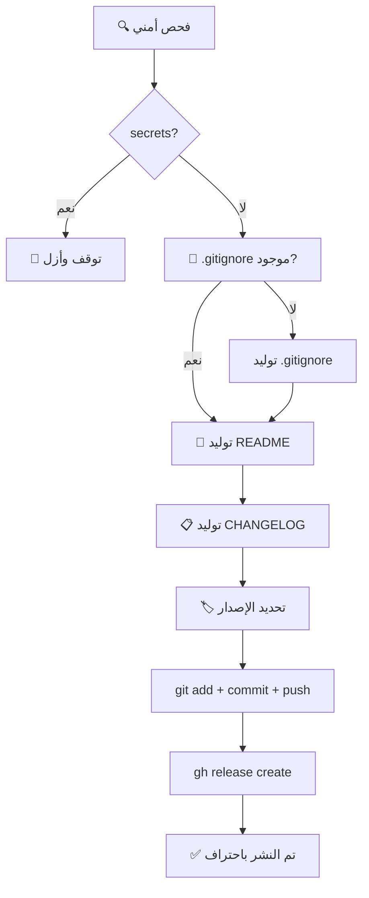

# GitHub Publisher Pro — ناشر GitHub المحترف

> نشر مشاريعك على GitHub بأعلى معايير الاحتراف — تلقائياً.

## المتطلبات
- `gh` CLI مثبت ومسجل الدخول (`gh auth status`)
- `git` مُعد (`git config user.name` / `git config user.email`)

---

## 1. فحص أمني قبل النشر 🔒

### قبل أي `git push` أو `gh repo create`، نفذ هذه الفحوصات بالترتيب:

### الخطوة 1: فحص الملفات الحساسة
```powershell
# بحث عن secrets محتملة في الكود
$patterns = @(
    'password\s*=\s*["\x27].+["\x27]',
    'api[_-]?key\s*=\s*["\x27].+["\x27]',
    'secret\s*=\s*["\x27].+["\x27]',
    'token\s*=\s*["\x27].+["\x27]',
    '-----BEGIN (RSA |EC |DSA )?PRIVATE KEY-----',
    'AKIA[0-9A-Z]{16}',          # AWS Access Key
    'sk-[a-zA-Z0-9]{48}',        # OpenAI key
    'ghp_[a-zA-Z0-9]{36}',       # GitHub PAT
    'gho_[a-zA-Z0-9]{36}',       # GitHub OAuth
    'AIza[0-9A-Za-z\-_]{35}'     # Google API Key
)

$found = $false
foreach ($pattern in $patterns) {
    $matches = Get-ChildItem -Recurse -File -Exclude *.exe,*.dll,*.png,*.jpg,*.zip |
        Select-String -Pattern $pattern -List
    if ($matches) {
        Write-Host "🔴 SECRET FOUND: $pattern" -ForegroundColor Red
        $matches | ForEach-Object { Write-Host "   📄 $($_.Path):$($_.LineNumber)" }
        $found = $true
    }
}
if (-not $found) { Write-Host "✅ No secrets detected" -ForegroundColor Green }
```

### الخطوة 2: التحقق من .gitignore
الملف `.gitignore` يجب أن يتضمن على الأقل:

```gitignore
# Environment & Secrets
.env
.env.*
!.env.example
*.pem
*.key

# Dependencies
node_modules/
vendor/
__pycache__/
*.pyc
.dart_tool/
.packages

# Build artifacts
dist/
build/
out/
*.exe
*.dll

# IDE
.idea/
.vscode/
*.swp
*.swo
.DS_Store
Thumbs.db

# Logs
*.log
npm-debug.log*

# OS
desktop.ini
```

### الخطوة 3: فحص الملفات الكبيرة
```powershell
# ملفات أكبر من 10MB (GitHub يحظر >100MB)
Get-ChildItem -Recurse -File | Where-Object { $_.Length -gt 10MB } |
    Select-Object FullName, @{N='SizeMB';E={[math]::Round($_.Length/1MB,2)}} |
    Sort-Object SizeMB -Descending
```

---

## 2. توليد README.md ذكي 📝

### قالب README الاحترافي

عند تحليل المشروع، ولّد README يتضمن هذه الأقسام:

```markdown
# 📦 اسم المشروع

> وصف مختصر وجذاب في سطر واحد

[]()
[]()
[]()

## 🚀 نظرة سريعة
وصف موسع يشرح ما يفعله المشروع ولماذا هو مفيد.

## ✨ المميزات
- ميزة 1
- ميزة 2
- ميزة 3

## 📋 المتطلبات
- Node.js >= 18
- أي متطلبات أخرى

## ⚡ التثبيت السريع

\```bash
git clone https://github.com/USER/REPO.git
cd REPO
npm install
\```

## 🔧 الاستخدام

\```bash
npm start
\```

## 📁 هيكل المشروع

\```
├── src/           # الكود المصدري
├── tests/         # الاختبارات
├── docs/          # التوثيق
└── README.md
\```

## 🤝 المساهمة
المساهمات مرحب بها! راجع [CONTRIBUTING.md](CONTRIBUTING.md)

## 📄 الرخصة
[MIT](LICENSE)

## 👤 المؤلف
**اسمك** — [@username](https://github.com/username)
```

### Badges الذكية
حسب نوع المشروع، أضف badges مناسبة:

| نوع المشروع | Badges |
| :--- | :--- |
| **Node.js** | `node`, `npm`, `build`, `coverage` |
| **Python** | `python`, `pip`, `tests`, `codecov` |
| **Flutter/Dart** | `flutter`, `dart`, `platform` |
| **أي مشروع** | `license`, `version`, `PRs welcome`, `stars` |

---

## 3. CHANGELOG تلقائي 📋

### أسلوب Conventional Commits

| البادئة | المعنى | مثال |
| :--- | :--- | :--- |
| `feat:` | ميزة جديدة | `feat: add user authentication` |
| `fix:` | إصلاح خطأ | `fix: resolve login timeout` |
| `docs:` | توثيق | `docs: update README` |
| `style:` | تنسيق | `style: format code with prettier` |
| `refactor:` | إعادة هيكلة | `refactor: extract auth service` |
| `perf:` | تحسين أداء | `perf: optimize database queries` |
| `test:` | اختبارات | `test: add unit tests for auth` |
| `chore:` | صيانة | `chore: update dependencies` |
| `ci:` | CI/CD | `ci: add GitHub Actions workflow` |
| `build:` | بناء | `build: configure webpack` |

### توليد CHANGELOG.md

```powershell
# توليد CHANGELOG من commits
$lastTag = git describe --tags --abbrev=0 2>$null
if (-not $lastTag) { $lastTag = (git rev-list --max-parents=0 HEAD) }

$commits = git log "$lastTag..HEAD" --pretty=format:"%s|%h|%an|%ad" --date=short

$changelog = "# Changelog`n`n## [Unreleased]`n"
$feats = @(); $fixes = @(); $others = @()

foreach ($line in $commits -split "`n") {
    $parts = $line -split '\|'
    $msg = $parts[0]; $hash = $parts[1]; $date = $parts[3]
    if ($msg -match '^feat') { $feats += "- $msg ($hash) — $date" }
    elseif ($msg -match '^fix') { $fixes += "- $msg ($hash) — $date" }
    else { $others += "- $msg ($hash) — $date" }
}

if ($feats) { $changelog += "`n### ✨ Features`n" + ($feats -join "`n") + "`n" }
if ($fixes) { $changelog += "`n### 🐛 Bug Fixes`n" + ($fixes -join "`n") + "`n" }
if ($others) { $changelog += "`n### 📦 Other Changes`n" + ($others -join "`n") + "`n" }

$changelog | Set-Content CHANGELOG.md -Encoding UTF8
```

---

## 4. Semantic Versioning 🏷️

### قواعد تحديد الإصدار التالي

```
MAJOR.MINOR.PATCH — مثال: 1.2.3
```

| نوع التغيير | التحديث | مثال |
| :--- | :--- | :--- |
| Breaking change | **MAJOR** ++ | `1.2.3` → `2.0.0` |
| ميزة جديدة (feat) | **MINOR** ++ | `1.2.3` → `1.3.0` |
| إصلاح خطأ (fix) | **PATCH** ++ | `1.2.3` → `1.2.4` |

### سكربت تحديد الإصدار التالي
```powershell
$lastTag = git describe --tags --abbrev=0 2>$null
if (-not $lastTag) {
    Write-Host "📌 First release: v1.0.0"
    return
}

$version = $lastTag -replace '^v', ''
$parts = $version -split '\.'
$major = [int]$parts[0]; $minor = [int]$parts[1]; $patch = [int]$parts[2]

$commits = git log "$lastTag..HEAD" --pretty=format:"%s"
$hasBreaking = $commits | Where-Object { $_ -match 'BREAKING CHANGE|^feat!|^fix!' }
$hasFeat = $commits | Where-Object { $_ -match '^feat' }
$hasFix = $commits | Where-Object { $_ -match '^fix' }

if ($hasBreaking) {
    $nextVersion = "v$($major+1).0.0"
    Write-Host "🔴 MAJOR: $nextVersion (breaking changes detected)"
} elseif ($hasFeat) {
    $nextVersion = "v$major.$($minor+1).0"
    Write-Host "🟡 MINOR: $nextVersion (new features)"
} elseif ($hasFix) {
    $nextVersion = "v$major.$minor.$($patch+1)"
    Write-Host "🟢 PATCH: $nextVersion (bug fixes)"
} else {
    Write-Host "⚪ No version bump needed"
}
```

---

## 5. سير العمل الكامل للنشر



---

## 6. أوامر النشر السريع

### نشر مشروع جديد بالكامل
```powershell
# 1. إنشاء مستودع
gh repo create PROJECT-NAME --public --description "وصف" --source . --push

# 2. إنشاء إصدار أول
gh release create v1.0.0 --generate-notes --title "v1.0.0 — الإصدار الأول 🎉"
```

### تحديث مشروع قائم
```powershell
# 1. Commit بأسلوب Conventional
git add .
git commit -m "feat: وصف الميزة الجديدة"
git push origin main

# 2. إنشاء إصدار (إن كان مطلوباً)
gh release create v1.1.0 --generate-notes --title "v1.1.0"
```

> [!TIP]
> استخدم `gh repo create --source . --push` لنشر مجلد محلي مباشرة كمستودع GitHub — أسرع طريقة!
