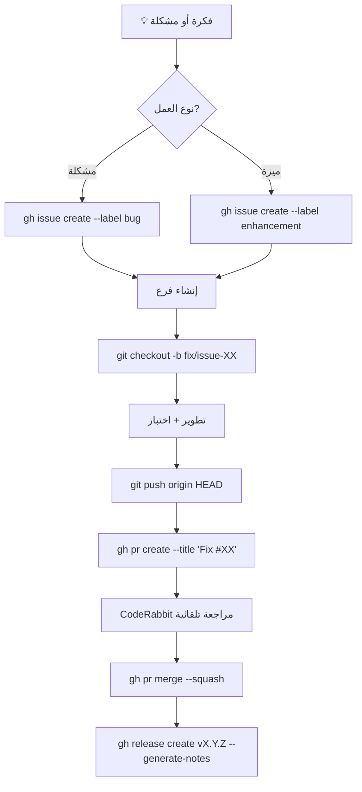

# GitHub Workflow Master — سيد إدارة GitHub

> المهارة الشاملة لإدارة GitHub من داخل Antigravity — PRs، Issues، Actions، Releases، والإشعارات.

## المتطلبات الأساسية

### أدوات مطلوبة
- **`gh`** (GitHub CLI) — مُثبت ومسجل الدخول
- **`git`** — مُثبت ومُعد

### التحقق السريع
```powershell
gh auth status
git config user.name
```

> [!CAUTION]
> إذا لم يكن `gh` مثبتاً: `winget install --id GitHub.cli`
> إذا لم يكن مسجل الدخول: `gh auth login`

---

## 1. إدارة Pull Requests 🔀

### إنشاء PR احترافي
```powershell
# التأكد من وجود تغييرات محلية
git status
git add .
git commit -m "feat: وصف التغيير"
git push origin HEAD

# إنشاء PR مع وصف احترافي
gh pr create --title "feat: عنوان واضح" --body @pr-body.md --label "enhancement"
```

### قالب وصف PR الاحترافي
عند إنشاء PR، استخدم هذا القالب:

```markdown
## ما تم تغييره
- وصف مختصر للتغييرات

## لماذا
- السبب والسياق

## كيف تم الاختبار
- [ ] اختبارات وحدات
- [ ] اختبار يدوي
- [ ] تم التحقق من عدم وجود أخطاء

## Screenshots (إن وجد)
لا ينطبق
```

### عمليات PR الشائعة
```powershell
# عرض PRs المفتوحة
gh pr list

# عرض تفاصيل PR محدد
gh pr view <number>

# مراجعة PR (approve/comment/request-changes)
gh pr review <number> --approve --body "LGTM ✅"

# دمج PR
gh pr merge <number> --squash --delete-branch

# إغلاق PR بدون دمج
gh pr close <number> --comment "Closing: reason..."

# عرض diff لـ PR
gh pr diff <number>

# Checkout فرع PR محلياً
gh pr checkout <number>
```

### البحث في PRs
```powershell
# PRs التي أنشأتها
gh pr list --author @me

# PRs تنتظر مراجعتك
gh pr list --search "review-requested:@me"

# PRs مدمجة آخر 7 أيام
gh pr list --state merged --search "merged:>$(Get-Date (Get-Date).AddDays(-7) -Format yyyy-MM-dd)"
```

---

## 2. إدارة Issues 🐛

### إنشاء Issue
```powershell
# Issue بسيط
gh issue create --title "Bug: وصف المشكلة" --body "تفاصيل..." --label "bug"

# Issue مع assignee
gh issue create --title "Feature: ميزة جديدة" --body "..." --label "enhancement" --assignee @me

# Issue من ملف
gh issue create --title "Title" --body-file issue-body.md
```

### قالب Issue الاحترافي
```markdown
## وصف المشكلة
وصف واضح ومختصر.

## خطوات إعادة الإنتاج
1. اذهب إلى '...'
2. اضغط على '...'
3. لاحظ الخطأ

## السلوك المتوقع
ما كان يجب أن يحدث.

## السلوك الفعلي
ما حدث فعلاً.

## البيئة
- OS: Windows 11
- Version: x.y.z
```

### عمليات Issues الشائعة
```powershell
# عرض Issues المفتوحة
gh issue list

# عرض Issue محدد
gh issue view <number>

# إغلاق Issue
gh issue close <number> --comment "Fixed in PR #XX"

# إعادة فتح Issue
gh issue reopen <number>

# تعديل Issue
gh issue edit <number> --add-label "priority:high" --add-assignee @me

# البحث في Issues
gh issue list --label "bug" --assignee @me
```

---

## 3. مراقبة GitHub Actions ⚡

### عرض حالة Workflows
```powershell
# آخر workflow runs
gh run list --limit 10

# runs لـ workflow محدد
gh run list --workflow "ci.yml"

# runs فاشلة فقط
gh run list --status failure

# تفاصيل run محدد
gh run view <run-id>

# عرض logs لـ run فاشل
gh run view <run-id> --log-failed
```

### إدارة Workflows
```powershell
# إعادة تشغيل run فاشل
gh run rerun <run-id>

# إعادة تشغيل jobs الفاشلة فقط
gh run rerun <run-id> --failed

# إلغاء run جارٍ
gh run cancel <run-id>

# تشغيل workflow يدوياً
gh workflow run <workflow-name>

# عرض كل workflows
gh workflow list
```

### مراقبة حية
```powershell
# متابعة run حي (يعرض الحالة كل ثانية)
gh run watch <run-id>
```

---

## 4. إنشاء Releases 🏷️

### إنشاء Release
```powershell
# إنشاء tag أولاً
git tag v1.0.0
git push origin v1.0.0

# إنشاء release مع ملاحظات تلقائية
gh release create v1.0.0 --generate-notes --title "v1.0.0 - إصدار جديد"

# release مع ملاحظات مخصصة
gh release create v1.0.0 --notes-file CHANGELOG.md --title "v1.0.0"

# release مع ملفات مرفقة
gh release create v1.0.0 ./dist/*.zip --title "v1.0.0"

# إنشاء draft release (غير منشور)
gh release create v1.0.0 --draft --title "v1.0.0 Draft"

# إنشاء prerelease
gh release create v1.0.0-beta.1 --prerelease --title "v1.0.0 Beta 1"
```

### إدارة Releases
```powershell
# عرض آخر releases
gh release list

# عرض release محدد
gh release view v1.0.0

# تحميل release
gh release download v1.0.0

# حذف release
gh release delete v1.0.0 --yes
```

---

## 5. إدارة الإشعارات 🔔

```powershell
# عرض الإشعارات
gh api notifications --jq '.[].subject | {title, type, url}'

# عرض إشعارات مستودع محدد
gh api "repos/OWNER/REPO/notifications"

# تعليم كل الإشعارات كمقروءة
gh api -X PUT notifications --field read=true
```

---

## 6. تحليل المستودع 📊

### إحصائيات سريعة
```powershell
# معلومات المستودع
gh repo view

# عرض المساهمين
gh api "repos/OWNER/REPO/contributors" --jq '.[] | {login, contributions}'

# عدد Stars, Forks, Issues
gh repo view --json stargazerCount,forkCount,openIssues

# عرض اللغات المستخدمة
gh api "repos/OWNER/REPO/languages"

# آخر 10 commits
gh api "repos/OWNER/REPO/commits?per_page=10" --jq '.[].commit | {message: .message, date: .author.date}'
```

### فحص صحة المستودع
```powershell
# هل يوجد LICENSE?
gh api "repos/OWNER/REPO/license" 2>$null && echo "✅ LICENSE exists" || echo "❌ No LICENSE"

# هل يوجد CONTRIBUTING?
gh api "repos/OWNER/REPO/contents/CONTRIBUTING.md" 2>$null && echo "✅" || echo "❌"

# عدد Issues المفتوحة vs المغلقة
$open = (gh issue list --state open --json number | ConvertFrom-Json).Count
$closed = (gh issue list --state closed --json number --limit 1000 | ConvertFrom-Json).Count
Write-Host "Open: $open | Closed: $closed"
```

---

## 7. إدارة المستودعات 📁

```powershell
# إنشاء مستودع جديد
gh repo create my-project --public --description "وصف المشروع" --clone

# إنشاء مستودع خاص
gh repo create my-private-project --private --clone

# حذف مستودع (تأكيد مطلوب)
gh repo delete OWNER/REPO --yes

# Fork مستودع
gh repo fork OWNER/REPO --clone

# تعيين مستودع كـ template
gh api -X PATCH "repos/OWNER/REPO" -f is_template=true

# إعدادات المستودع
gh repo edit --description "New description" --homepage "https://example.com"
```

---

## 8. GitHub API المباشر 🔌

```powershell
# أي API endpoint
gh api <endpoint>

# مع بارامترات
gh api repos/OWNER/REPO/issues -f title="Bug" -f body="Details"

# GraphQL
gh api graphql -f query='{ viewer { login, repositories(first:5) { nodes { name } } } }'

# Pagination
gh api repos/OWNER/REPO/stargazers --paginate --jq '.[].login'
```

---

## سير العمل الموصى به



---

## التكامل مع الإضافات الأخرى

| الإضافة | التكامل |
| :--- | :--- |
| **`coderabbit`** | مراجعة كود AI تلقائية على كل PR |
| **`github-scout`** | بحث واستكشاف المستودعات المفتوحة |
| **`github-publisher`** | نشر مشاريع جاهزة على GitHub |
| **`real-machine-verifier`** | اختبار حقيقي قبل إنشاء PR |

> [!TIP]
> **الاختصار الذهبي:** `gh pr create` ثم `gh pr merge --squash --delete-branch` — هذا كل ما تحتاجه لدورة تطوير كاملة!
