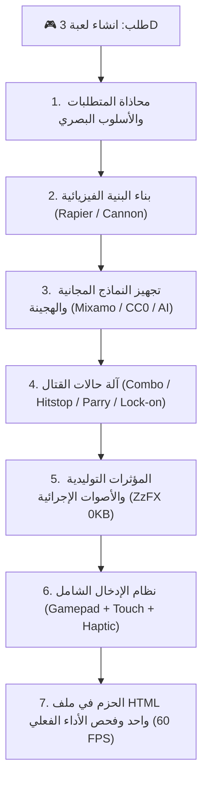

# Guizang Game Pro (المحرك المطور لألعاب الويب ثلاثية الأبعاد)

> الجيل المطور من مهارة صناعة ألعاب المتصفح ثلاثية الأبعاد بالذكاء الاصطناعي — من الفكرة إلى ملف `HTML` مستقل كامل المكونات وبأعلى معايير الأداء والفيزياء والمتعة الحركية.

---

## ⚡ قاعدة التفعيل التلقائي (Auto-Trigger Mandate)
بمجرد أن يكتب المستخدم عبارة تحتوي على:
**"انشاء لعبة"** أو **"إنشاء لعبة"** أو **"اصنع لعبة"** أو **"بناء لعبة 3D"** أو أي طلب لتطوير لعبة متصفح:
يتم تفعيل هذا البروتوكول فوراً لقيادة عملية التطوير وتجنب النماذج البدائية والمكعبات الرمادية.

---

## 🏗️ الركائز السبع للنسخة المطورة (The 7 Pillars)

---

## 📋 مراحل الإنتاج خطوة بخطوة

| المرحلة | المهام المنجزة | معيار التسليم |
| :--- | :--- | :--- |
| **0. التخطيط والأسلوب** | تحديد زاوية الكاميرا (Isometric أو Third-Person)، النمط (Dark Fantasy, Sci-Fi, Cyberpunk, Wuxia, أو تاريخي/عربي). | موافقة المستخدم على وثيقة الفكرة والتصميم. |
| **1. قاعدة الرندرة والفيزياء** | تهيئة Three.js، الإضاءة، الضباب، ومحرك فيزياء للجاذبية والاصطدام وصعود المنحدرات. | مشهد أساسي مستقر يتحرك فيه البطل بسلاسة. |
| **2. بيئة اللعبة والتضاريس** | الأرضية، العشب، الصخور، المباني، الإضاءة الديناميكية والظلال الناعمة. | بيئة تفاعلية جميلة بجودة بصرية مريحة للعين. |
| **3. الشخصيات والهياكل** | ربط الشخصيات بالهيكل العظمي مع حركات الجري، الهجوم، والموت من Mixamo أو النماذج الإجرائية. | بطل وأعداء يتحركون بحركات انسيابية بدون تشوه في المفاصل. |
| **4. نظام القتال الحركي** | الضربات المتتالية (Combos)، إيقاف الإطار عند الإصابة (Hitstop)، الصد (Parry)، التراجع (Knockback). | تجربة قتال ممتعة ومحكمة وذات استجابة فورية. |
| **5. الذكاء الاصطناعي للأعداء** | دوران وتطويق اللاعب (Flocking AI)، وتناوب الهجوم بدلاً من التجمع العشوائي، ومراحل الزعيم. | أعداء يتحركون بذكاء تكتيكي وزعيم بمرحلتين. |
| **6. الأصوات والواجهات** | أصوات إجرائية فورية (ZzFX) لا تستهلك أي مساحة، واجهة نقاط الصحة، عداد الكومبو، وموسيقى تصويرية. | واجهة أنيقة وأصوات تفاعلية لكل ضربة وحركة. |
| **7. الحزم والفحص الواقعي** | الحزم بملف HTML واحد مستقل، وتشغيل اللعبة محلياً وفحص ثبات الـ 60 FPS عبر `real-machine-verifier`. | ملف HTML يعمل بنقرة زر بدون أي متطلبات. |

---

## 🛠️ المراجع التقنية المتخصصة (راجع كل ملف بحسب الحاجة):

1. **`references/physics-engine.md`**:
   - إعداد المحرك الفيزيائي (Rapier WASM أو Cannon-es)، المتحكم الحركي بالشخصية (Kinematic Character Controller)، كشف المنحدرات والقفز والتصادم مع الجدران.
2. **`references/free-assets-pipeline.md`**:
   - خط توريد النماذج والوسائط المجانية والهجينة: مكتبات Kenney CC0، مجسمات Poly Pizza، حركات Mixamo العظمية، وتحويل الصور إلى مجسمات بـ AI.
3. **`references/combat-state-machine.md`**:
   - آلة حالات القتال المتكاملة: نظام الضربات، إطارات الحصانة أثناء المراوغة (I-Frames)، تجميد الإطار (Hitstop)، تثبيت الهدف (Lock-On)، واستهلاك الطاقة (Stamina).
4. **`references/procedural-audio-vfx.md`**:
   - التوليد الإجرائي للأصوات بـ ZzFX و Web Audio API بحجم 0KB، والـ Shaders المخصصة لضربات السيوف والمقذوفات والتوهج السينمائي.
5. **`references/packaging-and-mobile.md`**:
   - الحزم في ملف HTML واحد مضغوط (< 8MB)، دعم ذراع التحكم PlayStation / Xbox، وأزرار اللمس مع الاهتزاز التفاعلي للهواتف الذكية.

---

## 🕹️ أدوات البرمجة الجاهزة المرفقة مع المهارة:
- **`scripts/input-gamepad.js`**: يدعم الكيبورد والماوس ويد التحكم وأزرار اللمس، مع لوحة التشخيص المباشرة (F3).
- **`scripts/sound-synth.js`**: محرك صوتي كامل في 100 سطر يولد أصوات السيوف، الانفجارات، القفز، الموت، بدون أي ملف صوتي خارجي!
- **`scripts/build_single_html.mjs`**: سكربت الحزم الذكي لإنتاج ملف HTML متكامل ومضغوط.

---

## ⚡ بروتوكول التحقق الواقعي الميداني (Live Verification Protocol):
بعد إنشاء كود اللعبة أو ملف الـ HTML:
1. يتم تشغيل خادم محلي بصمت وفحص استجابة اللعبة.
2. يتم فحص مخرجات الـ Console للتأكد من عدم وجود أي خطأ WebGL أو Shader Error.
3. يتم إطلاق اللعبة أمام المستخدم في المتصفح أو نافذة مخصصة لتجربتها والاستمتاع بها فوراً!
