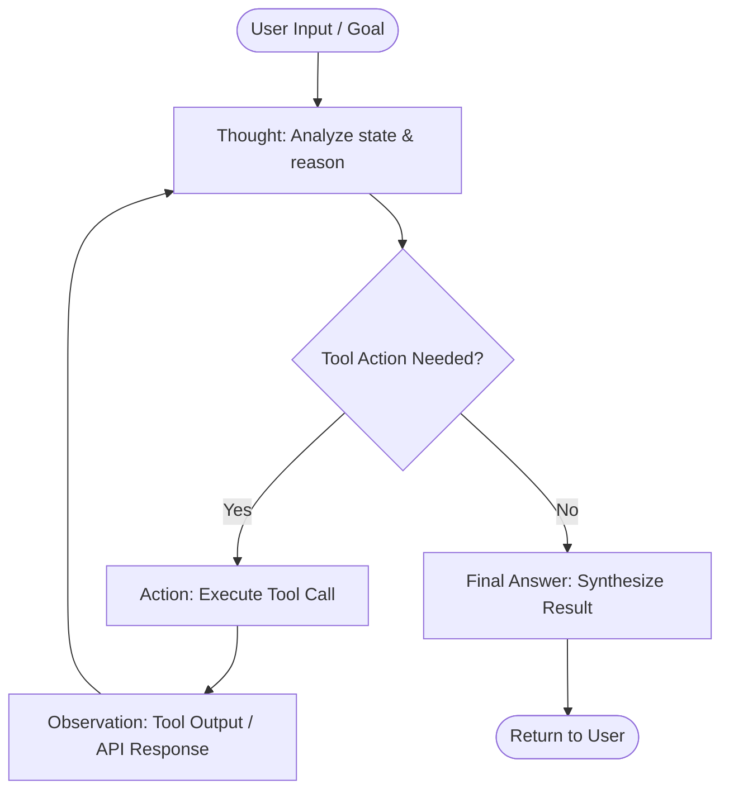
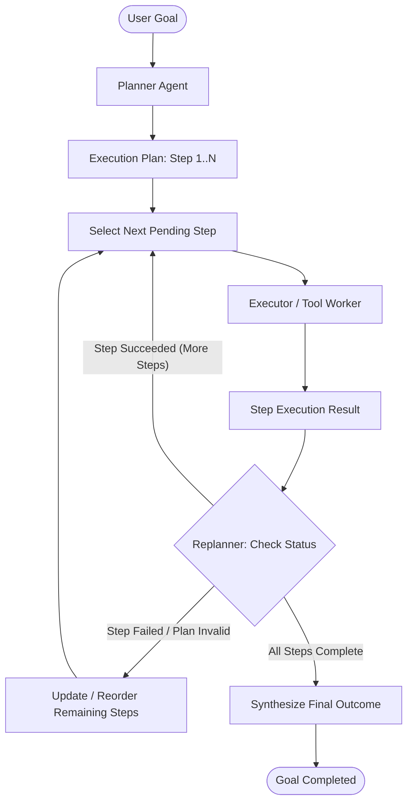
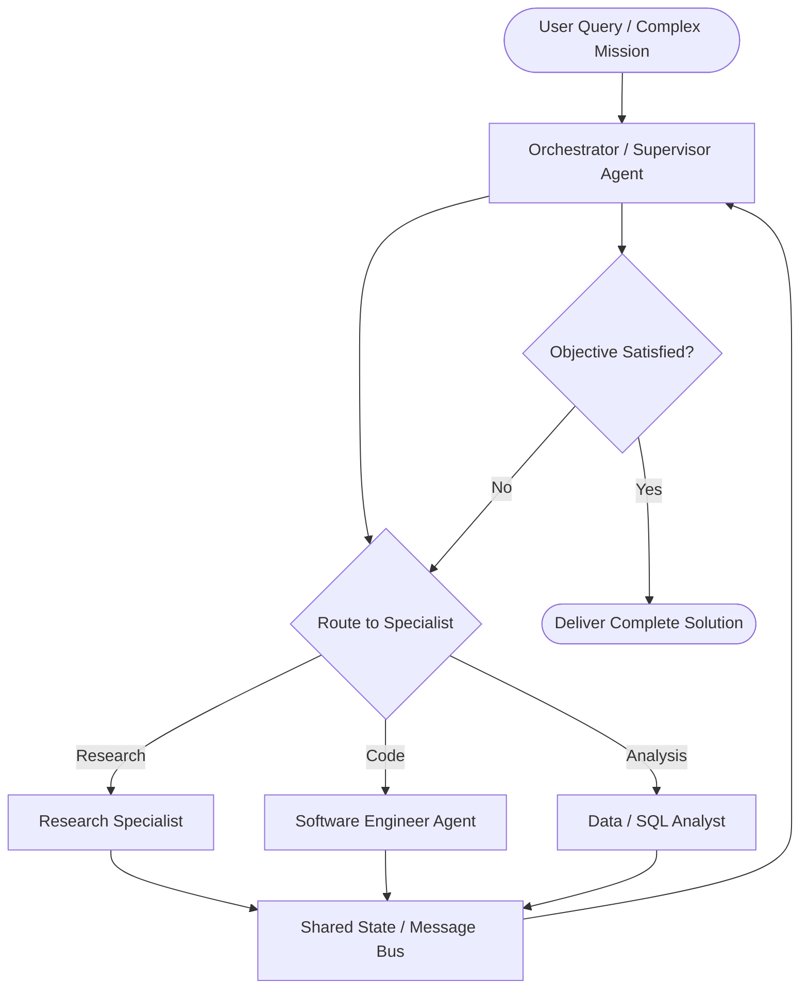
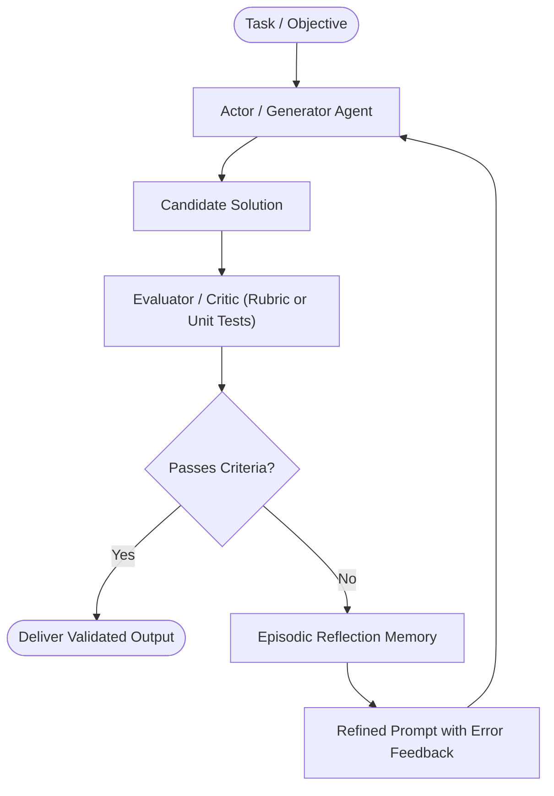

# Agentic Design Patterns Reference Guide

This reference provides visual diagrams, control flow semantics, and comparative selection criteria for the core AI agent design patterns.

---

## 1. ReAct (Reasoning + Acting) Loop

The ReAct pattern alternates between verbal reasoning steps ("Thoughts"), concrete environment interactions ("Actions" via tools), and feedback interpretation ("Observations").

### Key Dynamics:
- **Observation Feeding**: Each observation updates the working scratchpad memory.
- **Circuit Breaker**: Guard with a loop counter (`max_iterations = 8`) to prevent endless reasoning loops.
- **Strengths**: High adaptability to unexpected runtime outputs.

---

## 2. Plan-and-Execute Pattern

Separates high-level strategic reasoning from low-level execution mechanics. A Planner establishes the roadmap, an Executor carries out atomic actions, and a Replanner adjusts course if blockers occur.

### Key Dynamics:
- **Token Efficiency**: The executor prompt stays lightweight because it only handles one discrete sub-task at a time.
- **Predictability**: Clear intermediate milestones provide transparency for user progress tracking.

---

## 3. Multi-Agent Orchestrator Pattern

Employs a central Orchestrator / Supervisor that dispatches sub-tasks to specialized domain agents, aggregating their individual deliverables into a unified outcome.

### Key Dynamics:
- **Separation of Concerns**: Each agent possesses tailored system prompts, specialized tools, and isolated context windows.
- **State Bus**: Communication happens via structured typed messages rather than unstructured free text.

---

## 4. Reflexion & Self-Critique Pattern

Enforces rigorous output verification by subjecting candidate drafts to automated or LLM-based critique loops before finalizing.

### Key Dynamics:
- **Feedback Grounding**: Critiques must highlight specific violations, failing unit tests, or missing edge cases.
- **Memory Accumulation**: Reflections persist across attempts, preventing the agent from repeating previous errors.

---

## Pattern Comparison Matrix

| Pattern | Complexity | Latency | Token Cost | Determinism | Best Applied In |
|---|---|---|---|---|---|
| **ReAct** | Medium | Medium | Medium | Medium | API troubleshooting, interactive research, database querying |
| **Plan-and-Execute** | Medium-High | High | Medium | High | Large refactoring, multi-stage data ETL, structured audits |
| **Multi-Agent Orchestrator** | High | High | High | High | Complex software development, multi-domain analytics, cross-team simulations |
| **Reflexion** | Medium | Medium-High | High | Very High | Code generation, schema-strict JSON extraction, mathematical proofs |

---

## Pattern Selection Decision Tree

1. **Does the task have known, predictable stages?**
   - **YES** ➔ Choose **Plan-and-Execute**.
   - **NO** ➔ Proceed to step 2.
2. **Does the task require distinct domain personas or isolated tool sets?**
   - **YES** ➔ Choose **Multi-Agent Orchestrator**.
   - **NO** ➔ Proceed to step 3.
3. **Is formal correctness verifiable by tests or deterministic rubrics?**
   - **YES** ➔ Choose **Reflexion / Self-Critique**.
   - **NO** ➔ Choose **ReAct**.
