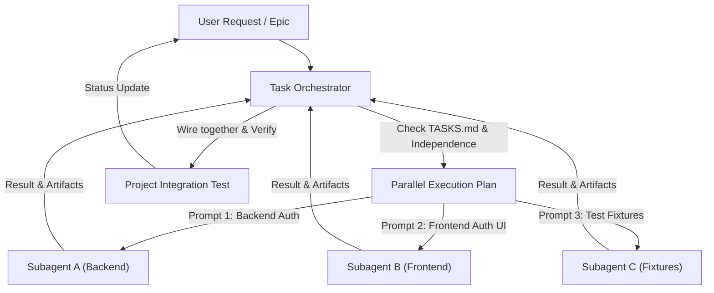

# Parallel Agent Planner Skill

## Overview
The `parallel-agent-planner` skill enables the orchestrator to dissect multi-faceted projects into disjoint, safe workstreams and delegate them to parallel subagents. It optimizes turnaround time while preventing race conditions, file collisions, and architectural drift.

---

## When to Activate
Activate this skill whenever:
- Multiple tasks in `TASKS.md` have no direct dependency on one another.
- The project spans cleanly separable layers or directories (e.g., backend services vs frontend components, documentation vs unit tests).
- A monolithic milestone can be split across distinct modules or microservices.
- Time-to-completion is a high priority and the user approves multi-agent execution.

---

## Identifying Truly Independent Tasks

Before dispatching subagents, run the **Independence Audit**:

### 1. File & Directory Isolation
- **Rule of Zero Overlap**: No two subagents may have write access to the same files or directories.
- *Example Safe Split*:
  - Subagent A writes solely in `src/backend/services/billing/`
  - Subagent B writes solely in `src/frontend/components/billing/`
  - Subagent C writes tests in `tests/e2e/billing/`

### 2. Dependency Graph Independence
- Both tasks must have all their pre-requisites already marked `- [x]`.
- Neither task can depend on the outputs, interfaces, or migrations being authored by the other task concurrently.

### 3. Shared State & Lock Verification
- Ensure tasks do not compete for database lock mechanisms, exclusive port bindings, or package manager lockfiles (`package-lock.json`, `pnpm-lock.yaml`, `pubspec.lock`) at the same instant.

---

## Writing Effective Subagent Prompts

Every subagent prompt must be strictly scoped and self-contained. Include the following sections:

### Subagent Prompt Blueprint:
```markdown
You are a specialized subagent executing a dedicated task for the Task Orchestrator.

### Task Goal
[Brief, precise 1-sentence description of what needs to be created or fixed]

### Allowed Working Boundaries (STRICT)
- You may ONLY create or edit files in: `[allowed directory or file paths]`
- Do NOT modify any other files in the project.
- Do NOT run package install commands that modify root lockfiles unless explicitly instructed.

### Technical Specification & Interfaces
- Model definitions, types, or API signatures to use:
  [Insert exact types, interfaces, or mock contracts]
- Required conventions (naming, framework idioms, error handling):
  [List conventions]

### Acceptance & Verification Criteria
- [Criteria 1: e.g., Unit tests in tests/... must pass]
- [Criteria 2: e.g., Export service class matching interface X]

### Reporting
When complete, summarize:
1. Created files with absolute paths
2. Modified files
3. Verification results (test outputs, build checks)
4. Any notes or caveats for the Orchestrator
```

---

## Common Anti-Patterns to Prevent

### 1. File Collisions and Race Conditions
- **Symptom**: Subagent A and Subagent B both edit `app.module.ts` or `routes.ts` at the same time, overwriting each other's imports.
- **Prevention**: Central routing, module registries, or export index files must be edited exclusively by the parent orchestrator after subagents complete their isolated modules.

### 2. Dependency Installation Collisions
- **Symptom**: Both subagents run `npm install <pkg>` or `cargo add <pkg>` concurrently, corrupting lockfiles.
- **Prevention**: Pre-install all third-party libraries centrally before subagents launch.

### 3. Vague Scope Creep
- **Symptom**: A subagent asked to build a UI widget decides to refactor the global state store.
- **Prevention**: Explicitly list prohibited paths and boundaries in the prompt.

---

## Merging Results from Multiple Subagents

When subagents report back:
1. **Audit File Changes**: Verify that the files produced match the assigned boundaries.
2. **Integration Stitching**:
   - The Orchestrator registers the newly created components or services into central files (e.g., router, index barrel files, service container).
3. **Global Build & Test Run**:
   - Run linter: `npm run lint` or `cargo clippy`
   - Run typecheck: `npx tsc --noEmit`
   - Run test suite: `npm test`
4. **Update TASKS.md**:
   - Mark the completed subagent tasks as `- [x]`.
   - Log any follow-up tweaks or integration findings.

---

## Communication Patterns



---

## When NOT to Use Parallelism (Cost vs. Benefit)

Do **NOT** use parallel subagents when:
- **Tightly Coupled Sequential Steps**: Step B requires the actual output data or compiled schema of Step A.
- **Trivial Effort (< 15 mins)**: Setting up prompts, monitoring, and merging takes longer than executing directly.
- **Single Monolithic File**: All edits happen within the same single source file.
- **Exploratory Debugging**: Root cause is unknown; multiple agents will duplicate investigative effort.
- **Lockfile Contention**: Tasks frequently require adding new packages or running migrations.
